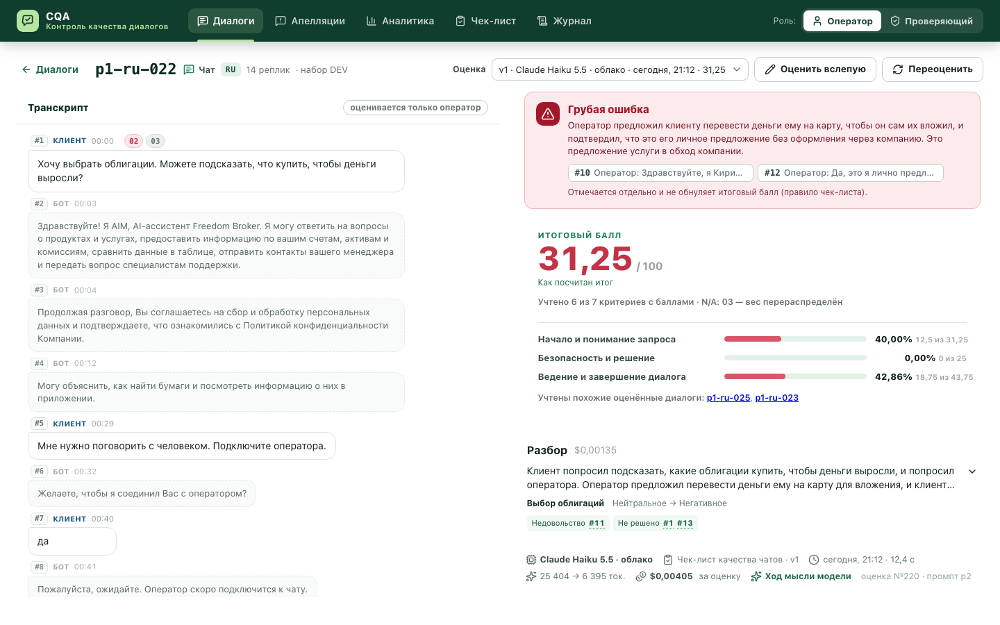
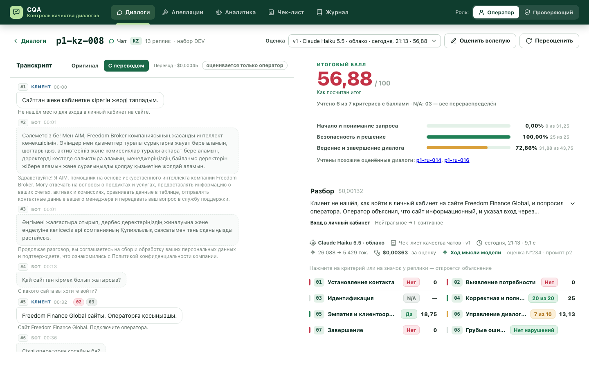
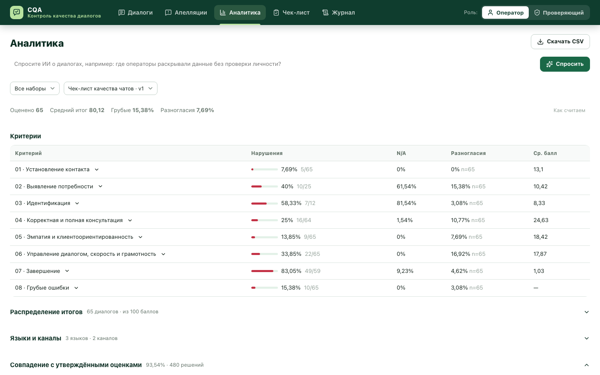
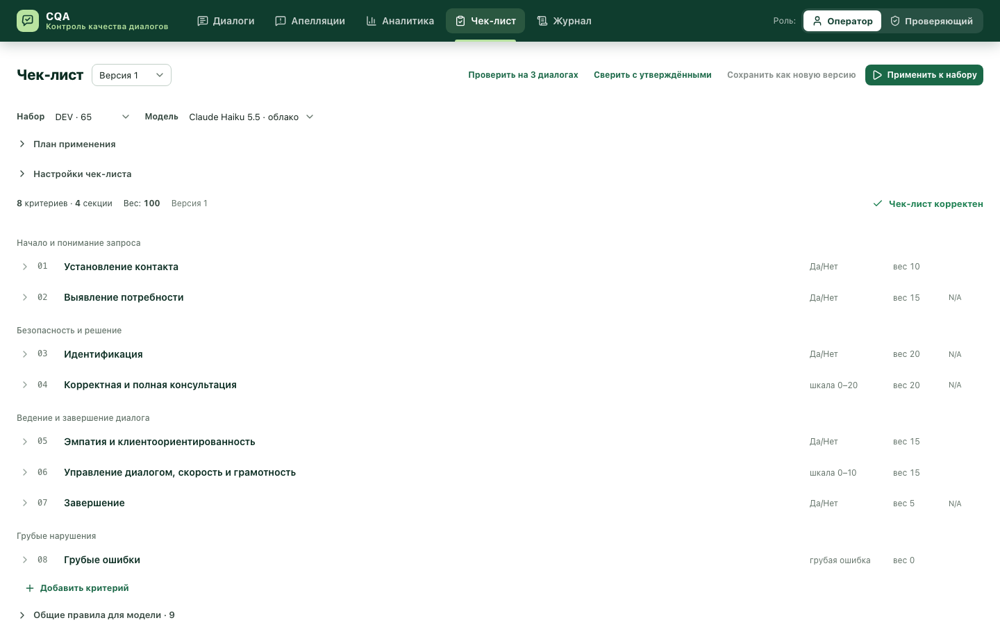
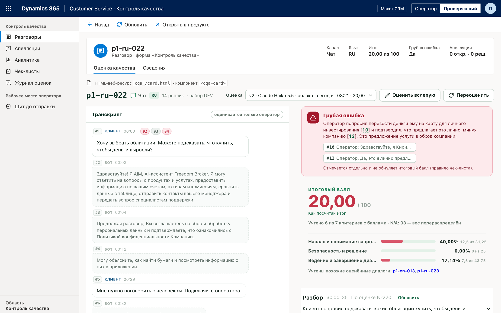

# Название оценки — ИИ оценивает работу оператора контакт-центра по чек-листу

**Команда: «Название команды»** — это настоящее название команды; оно же стоит в `team_name` файлов `results/*/results.json`.

**Попробовать без установки: https://cqa.oqcrm.kz** — тот же интерфейс на нашем сервере: 60 синтетических чатов DEV
с оценками модели; можно загрузить свои диалоги, оценить, оспорить критерий, поменять чек-лист. Модель — Claude Haiku 5.5;
на общем сервере запросы к модели ограничены по частоте и дневному бюджету. Пяти настоящих звонков DEV там нет —
записи клиентов не публикуем; звонки с плеером — в локальном запуске.

«Название оценки» — прототип Conversation Quality Analytics (CQA) для Freedom Broker (Data Challenge'26). ИИ оценивает диалог оператора
(чат или звонок, RU / KZ / EN) по настраиваемому чек-листу: по каждому критерию — ответ, баллы, вес, обоснование
и реплики-доказательства. Оператор оспаривает критерий, проверяющий подтверждает или меняет оценку, итог
пересчитывается. Итог считает код по формуле чек-листа, а не модель.



<p>



</p>

Карточка диалога (грубая ошибка, итог по формуле чек-листа, разбор и флаги) · казахский чат с переводом для проверяющего ·
аналитика с вопросом к ИИ · редактор чек-листа.

## Запуск

Нужен Python 3.11+ и [uv](https://docs.astral.sh/uv/) (или обычный `pip`, см. ниже).

```bash
git clone https://github.com/Oryntai/Team-name2 && cd Team-name2
cp .env.example .env        # впишите ключ Claude и ссылку API организаторов
uv sync
uv run python -m cqa        # → http://127.0.0.1:8000
```

Без uv: `python -m venv .venv && .venv/bin/pip install -r requirements.txt && .venv/bin/python -m cqa`
(Windows: `.venv\Scripts\pip …`, `.venv\Scripts\python -m cqa`).

Дальше всё в интерфейсе: «Загрузить диалоги» → `group_id` (например `DEV` или контрольный) → выбрать чек-лист и модель →
«Оценить все». Можно загрузить и JSON-файл в формате API организаторов (одна запись, список или ответ API целиком).

### Настройка (`.env`)

| Переменная | Зачем |
|---|---|
| `ANTHROPIC_API_KEY` | ключ Claude API для моделей Haiku 5.5 / Sonnet 5.5 |
| `CQA_DATASET_URL` | ссылка GET из гайда организаторов («Открыть GET для DEV»); `group_id` подставляется из интерфейса. Можно не задавать здесь, а вставить в настройках интерфейса |
| `CQA_LOCAL_BASE_URL`, `CQA_LOCAL_MODEL` | своя модель на OpenAI-совместимом сервере (vLLM, llama.cpp, Ollama, LM Studio) — режим без облака |
| `CQA_DB`, `CQA_PORT`, `CQA_HOST` | база (по умолчанию `var/cqa.db`), порт и адрес сервера |
| `CQA_PROVIDERS`, `CQA_BUDGET_USD` | для общего демо-сервера: какие модели можно выбрать (например `haiku`) и потолок трат на Claude за сутки, $. Не заданы — ограничений нет |

## Что умеет (по пунктам ТЗ)

| № | Функция | Где в интерфейсе |
|---|---|---|
| 01 | Чек-лист: критерии, формулировки, вес, тип ответа, N/A, шкала; каждая правка — новая версия | «Чек-лист» |
| 02 | Оценка выбранных диалогов или всего набора выбранным чек-листом и моделью; RU, KZ, EN; бот и системные события — контекст | «Диалоги» → «Оценить» |
| 03 | По критерию: ответ, баллы после перераспределения, вес, обоснование, реплики-доказательства; для пропуска — где ожидалось; для N/A — причина; итог, секции, отметка грубой ошибки; «Как посчитан итог» — баллы каждого критерия после перераспределения и формула | карточка диалога |
| 04 | Карточка: транскрипт с исходными метками времени, ссылка из обоснования ведёт к реплике; у звонка — плеер и переход к фрагменту записи | карточка диалога |
| 05 | Апелляция по критерию: причина (неверная трактовка, не та реплика, неверный N/A, другое) и комментарий | карточка, роль «Оператор» |
| 06 | Решение проверяющего: подтвердить или изменить + причина → пересчёт; видны исходная оценка, решение, «итог: было → стало» | «Апелляции», роль «Проверяющий» |
| — | Аналитика: нарушения и расхождения по критериям, распределение итогов, языки/каналы, совпадение с DEV-разметкой и проверяющими, очередь проверки, апелляции, CSV; темы и флаги при наличии разборов | «Аналитика» |
| — | Прецеденты: к каждому диалогу модель получает 2 самых похожих уже проверенных диалога с утверждёнными оценками (разметка DEV и решения проверяющих по апелляциям) — система учится на проверяющих; похожие ищутся на любом языке (казахский и английский диалоги сравниваются по русскому переводу, поэтому к казахскому чату находится русский на ту же тему); какие прецеденты учтены — видно в карточке | карточка диалога |
| — | Голосование и «Модель спрашивает»: 3 независимых прогона, ответ большинством; где прогоны разошлись, модель задаёт проверяющему вопрос — с правилом чек-листа, которое прогоны поняли по-разному, и доводом каждой позиции; ответ проверяющего — решение по диалогу (итог пересчитывается) и пример для похожих диалогов | карточка диалога, роль «Проверяющий» |
| — | Вопросы к чек-листу: спорные решения набора модель сводит в вопросы к формулировке критерия с вариантами-правилами; выбранное правило вставляется в пояснение черновика → «Сохранить» → «Применить» → «было → стало» по спорам; изменённый критерий без споров помечается «формулировка читается однозначно». На DEV 43 спорных решения из 520 свелись к вопросам о тех же серых зонах (02, 04, 06, 07), что мы уточняли у организаторов; ≈ $0,001–0,004 за вопрос, кеш | «Чек-лист» → «Вопросы к чек-листу» |
| — | «Подсказка ИИ»: черновик пояснения к критерию, проблемы формулировки и уточнение N/A с ручным принятием | редактор «Чек-лист» |
| — | Инкрементальное применение: модель оценивает только изменённые определения, веса пересчитываются без модели; план и «Что изменилось» | «Чек-лист» → «Применить к набору», пометки переноса в карточке |
| — | Песочница: проверить несохранённый чек-лист на 3 диалогах параллельно, увидеть «было → стало», обоснования и реплики без записи в базу | «Чек-лист» → «Проверить на 3 диалогах» |
| — | Сверка изменённых критериев с утверждёнными ответами DEV и решениями проверяющих: совпадения, расхождения, стоимость; до 12 диалогов по умолчанию, оценки не меняются | «Чек-лист» → «Сверить с утверждёнными оценками»; вызовы — в журнале |
| — | Звонок по меткам времени: длительность, удержания, доля речи, темп и паузы ответа; справочно, без анализа звука и влияния на балл | карточка звонка |
| — | Перевод KZ / EN на русский для проверяющего: ПДн скрыты, перевод сохраняется, стоимость видна; модель оценивает оригинал, перевод нужен только для поиска похожих диалогов (прецедентов) | карточка → «Перевести на русский» → «Оригинал / С переводом» |
| — | Разбор диалога: резюме в 2–3 предложения, тема и причина обращения, настроение клиента в начале и в конце, флаги «на что посмотреть» (недовольство, жалоба, риск ухода, обещан ответ, не решено, сбой бота) со ссылками на реплики и для каждого нарушенного критерия — «как можно было сказать»; отдельный вызов, на оценку не влияет | карточка → «Разобрать диалог»; темы и флаги — в «Аналитике» |
| — | Калибровка вслепую: человек оценивает диалог сам, не видя ответов модели, затем видит сравнение по критериям и итогу | карточка → «Оценить вслепую» |
| — | «Спросить ИИ»: вопрос по последним успешным оценкам, короткий ответ и ссылки на диалоги; фильтры набора и чек-листа | «Аналитика» → поле вверху; история, токены и стоимость — в «Журнале» |

Ещё: журнал прогонов (модель, время, токены, стоимость каждой оценки); маскировка личных данных перед моделью
(ИИН, номера карт, IBAN, телефоны, e-mail, паспорта — модель видит только метку «[ИИН скрыт]»);
интерфейс из веб-компонентов (`<cqa-card>`, `<cqa-checklist-editor>` …) — заготовка под веб-ресурс Dynamics 365;
весь продукт внутри макета Dynamics 365 — http://127.0.0.1:8000/d365.html (те же компоненты без правок; карточка на форме
записи «Разговор» берёт id через `Xrm.Page.data.entity.getId()`, как веб-ресурс CRM); щит до отправки — черновик ответа
оператора проверяется по тому же чек-листу до отправки клиенту (http://127.0.0.1:8000/guard.html).




## Рядом с готовыми системами

Автооценку диалогов уже делают Microsoft (Quality Evaluation Agent в Dynamics 365 — CRM контакт-центра), Zendesk QA,
Observe.AI и другие. Прототип встаёт рядом с ними, а не изобретает своё:
- чек-лист переносится в структуру Microsoft QEA один к одному: секции, веса, N/A, «критический вопрос» (наша грубая
  ошибка), инструкции к вопросу, версии, проверка черновика — таблица в
  [docs/ARCHITECTURE.md](docs/ARCHITECTURE.md#соответствие-microsoft-dynamics-365-quality-evaluation-agent);
- пояснение к каждому критерию для модели и своя небольшая модель, дообученная на ответах сильной
  ([docs/LOCAL.md](docs/LOCAL.md)), — тот же приём, что Observe.AI описывает в
  [статье EMNLP 2024](https://aclanthology.org/2024.emnlp-industry.60/);
- сверх этого — то, что требует ТЗ и чего нет в документации QEA: апелляция оператора с решением проверяющего,
  реплики-доказательства с переходом к ним; плюс отметка «оценки разошлись» и обучение на решениях проверяющих.

## Как устроено

```
API организаторов / файл → SQLite → маскировка ПДн → модель: 3 независимых вызова на диалог, строгая JSON-схема из чек-листа
→ ответ большинством по каждому критерию (голосование); к диалогу — 2 похожих утверждённых диалога (прецеденты;
  похожесть — по русскому тексту, KZ/EN — по переводу)
→ ответы по критериям + обоснования + номера реплик → итог кодом (формула чек-листа) → карточка → апелляция → решение
```

- Промпт и JSON-схема строятся из чек-листа: в схеме у каждого критерия свой список допустимых ответов, поэтому модель
  не может вернуть, например, N/A там, где он запрещён, или ступень, которой нет в шкале. Замена критерия в интерфейсе
  сразу меняет и промпт, и схему.
- Итог — по правилам чек-листа: «Да» = полный вес, шкала — пропорционально, N/A исключается с перераспределением веса
  до 100, округление до 2 знаков (половина вверх), грубая ошибка — отдельная отметка. Проверено автотестом на примере
  из чек-листа (93,08).
- Новые определения оценивает модель; неизменные ответы переносим по отпечаткам с указанием исходной оценки. Все вызовы и переносы видны в журнале.

Подробно — [docs/ARCHITECTURE.md](docs/ARCHITECTURE.md) (модули, формат чек-листа, база, HTTP API).

## Результаты для организаторов (`results/`)

По приложению к гайду «Как сдать результаты» (формат JSON 1.0): [`results/dev/results.json`](results/dev/results.json) —
DEV, 65 диалогов (60 чатов и 5 звонков); `results/prod/results.json` — контрольный набор, 10 чатов. Файлы собирает
одна команда — из той же базы и тем же прогоном, что интерфейс (прогон виден в журнале):

```bash
uv run python -m cqa.results dev                          # оценить недостающее, выгрузить results/dev/results.json
uv run python -m cqa.results prod --group-id <group_id>   # загрузить по API → оценить → выгрузить → «ровно 10»
uv run python -m cqa.results check results/prod/results.json   # проверить готовый файл по правилам приложения
```

- В файл идут ответы модели по действующему чек-листу (`cqa/checklists/default.json`). Диалог, оценённый по
  изменённому чек-листу (например, после замены критерия), переоценивается; решения проверяющих по апелляциям в файл
  не входят.
- `value` — ответ до учёта веса (true / false, null = N/A, ступень шкалы); `evidence_turns` — номера реплик с 1
  по исходному массиву, вместе с ботом и системными событиями; `final_score` считает формула чек-листа, а проверка
  сверяет его с независимым расчётом по правилам приложения.
- Диалог, который не удалось оценить и после повторов, записывается со `status: "error"` и причиной — без подмены нулём.
  Нечитаемая запись во входе (пустой транскрипт, реплика без роли) не отменяет набор: она идёт в файл со `status:
  "error"` и причиной, остальные оцениваются; реплика без текста или метки времени остаётся на своём месте (номера
  реплик не сдвигаются). Контроль из файла или по API всегда оценивается заново. Проверено на 67 странных входах.
- DEV целиком (7.11, ранний режим: один вызов, без прецедентов): 65 диалогов за 79 с, $0,081. С тремя голосами и
  прецедентами — $0,27 (таблица ниже).

## Модель и стоимость одной оценки

Одна оценка = 3 независимых вызова модели (в каждом — все критерии), по каждому критерию берётся ответ большинства.
Вызовы идут параллельно, поэтому по времени это как один вызов. Средние по DEV:

| Модель | Вход / выход, токенов | Стоимость одной оценки | Время |
|---|---|---|---|
| Claude Haiku 5.5 (`claude-haiku-5-5`, по умолчанию), 3 вызова с прецедентами | ~8 000 / ~1 800 на вызов | ≈ $0,0042 (DEV: 65 диалогов — $0,27) | ~10 с |
| То же, 1 вызов (`CQA_VOTES=1`) | ~5 400 / ~1 800 | ≈ $0,001 | ~9 с |
| Claude Sonnet 5.5 (`claude-sonnet-5-5`), 1 вызов | ~5 400 / ~700 | ≈ $0,011 | ~5 с |
| Своя модель на OpenAI-совместимом сервере | — | $0 | зависит от железа |

Модель выбирается при запуске оценки. Стоимость каждой оценки видна в журнале и в карточке.

### Два режима: облако или своя модель

Один и тот же продукт (чек-лист, прецеденты, итог кодом, карточка, апелляции) работает с облачной моделью или со своей
моделью на ноутбуке. Цель — чтобы банк выбирал по удобству развёртывания; облако пока точнее (таблица):

| | Облако | Своя модель |
|---|---|---|
| Модель | Claude Haiku 5.5, 3 голоса | Qwen3.5-9B + наш LoRA ([docs/LOCAL.md](docs/LOCAL.md)), 1 вызов, учитель — сам продукт |
| 21 отложенный чат DEV: медь / замысел авторов | 93,2% / 32 из 35 (среднее 6 прогонов; без поиска по переводу — 91,7% / 33) | 87,5% / 27 из 35 |
| 50 новых чатов (второй DEV) | 97,5% | 97,5% |
| 10 контрольных чатов | ~25 с | ~5,5 мин (MacBook M1 Pro 16 ГБ) |
| Цена оценки | ≈ $0,004 | $0 |
| Куда уходят диалоги | API Anthropic (ИИН, карты, телефоны замаскированы) | никуда (перевод и «Спросить ИИ» в интерфейсе — облачные, их можно не нажимать) |

Своя модель — `bash lab/local/serve.sh`, затем `CQA_LOCAL_BASE_URL`, `CQA_LOCAL_MODEL` в `.env` и `CQA_VOTES=1`
**в самой команде** (ответы с temperature 0 воспроизводимы, голосовать нечему). `CQA_VOTES=1` не класть в `.env`:
переменная общая, и облако тоже уйдёт в один голос. В `results/prod` сдаём облако: оно точнее.

## Точность

Эталона организаторов для DEV нет, поэтому сверяемся с «медным эталоном»: разметка 60 чатов DEV моделями-судьями
по тому же чек-листу (`lab/reference_copper.json`). Судьи — Claude Opus; критерии 02 и 07 переразмечены после ответа
организаторов по 02, у 20 чатов — GPT (gpt-6.1-sol через Codex CLI), его совпадение с Opus на остальных 40 — 95%.
21 чат отложен (`lab/holdout.json`): до v6 включительно на подгонку не использовался; правки v6f сделаны по разбору
ошибок на нём, поэтому чистая проверка v6f — отдельный набор из 50 новых чатов (`lab/sim`), см. ниже.

| | Обучающие 39 чатов | Отложенные 21 чат |
|---|---|---|
| Простая база «всё выполнено» | 58,7% | 54,8% |
| **Продукт: Haiku 5.5, чек-лист v6f, прецеденты, голосование 3** | **96,2%** | **92,9%** (не чистая проверка) |
| Продукт на чек-листе v6 | 95,2–95,8% | 89,3–91,7% |
| Haiku 5.5, чек-лист v6, один вызов | 95,2–97,1% | 89,3–92,3% |
| Haiku 5.5, чек-лист v5 | 94,7% | 91,1% |
| Sonnet 5.5, чек-лист v6 + прецеденты, один вызов (в 12 раз дороже Haiku) | 95,8–96,2% | 92,3% |

Доля совпавших решений по критериям (ответ, ступень шкалы, N/A, флаг грубой ошибки); итог диалога расходится
с эталоном в среднем на 3–4 балла. Отдельная проверка — «замысел авторов»: 101 решение, которое восстанавливается
по парам почти одинаковых чатов DEV с разным поведением оператора (`runs/design-intent.md`, не в репозитории);
продукт совпадает с ним на 96% (на v6 — 94%), v6 одним вызовом — на 91–92%, v5 — на 88–90%; Sonnet 5.5 на той же
связке — 93,6%, вровень с Haiku, поэтому в продукте Haiku. На 50 новых чатах вне DEV
(`lab/sim`, эталон другой модели), v6f — 98,3%, v6 — 97,2% (один вызов, замер в один заход). Прецеденты для диалога DEV берутся
из остальных диалогов: его собственная разметка в промпт не попадает. Нарушения, явно заложенные
в DEV (17 штук: нет приветствия, раскрытие данных без проверки личности, платная консультация в обход компании,
оскорбление, N/A по условию), находятся во всех прогонах. Одиночный вызов судьи без прецедентов и голосов повторяет `uv run python lab/eval_product.py --split holdout`
(нужен `data/dev.json`); режим продукта — `python -m cqa.results dev --fresh`.

### Справедливость

Проверка, что оценка не зависит от имени и пола (`lab/fairness.py`, как в статье Observe.AI
[arXiv 2602.14970](https://arxiv.org/abs/2602.14970)): в 20 чатах DEV модель заменяет имена оператора и клиента
на казахские, русские или английские и меняет пол оператора; код проверяет, что больше в репликах не изменилось
ни символа. Доля изменившихся решений по критериям: имена — 2,1–2,7%, пол — 2,2%; при простом повторе той же оценки —
1,9–3,4%. То есть влияние имени и пола не отличается от обычного разброса модели (в статье у 18 моделей —
5–13%; наборы разные). 54 варианта, $0,13.

## Тесты

```bash
uv run pytest
```

`tests/test_techspec.py` — правила из ТЗ и чек-листа (расчёт итога, N/A, шкалы, округление, замена критерия, исходные
метки времени), `tests/test_results.py` — формат results.json по приложению (пример организаторов, типы значений,
итог, ровно 10 записей), `tests/test_pii.py` — маскировка, `tests/test_api.py` — путь «загрузка → оценка →
апелляция → решение».

## Ограничения

- Точность измерена против разметки моделей-судей, а не экспертов организаторов. По 02 следуем ответу организаторов
  (N/A, если данных для ответа хватало). Строгость 07 и то, считать ли раскрытие данных без проверки личности грубой
  ошибкой, организаторы не уточнили — решаем по тексту чек-листа.
- Стартовая база прецедентов — наша разметка DEV судьями Claude Opus (`cqa/precedents/dev_reference.json`), а не
  эксперты организаторов; решения проверяющих по апелляциям её дополняют и перекрывают.
- В ~6% обоснований пересказ неточен (например, обещание «передам» описано как «передал»); ссылки на реплики при
  этом верные (аудит 480 обоснований DEV). Правило против этого ухудшало сами оценки — не включено.
- Звонки оцениваются по готовой расшифровке; интонация и дикция по звуку не оцениваются.
- Секунда реплики в записи считается по системным событиям записи (пауза / возобновление); расхождение — несколько секунд,
  поэтому плеер стартует чуть раньше реплики.

## Репозиторий

`cqa/` — сервер и ядро оценки · `web/` — интерфейс · `results/` — результаты для организаторов · `tests/` — тесты ·
`lab/` — замеры и эталон ·
`docs/` — архитектура · `experiments/` — пробы голосовых и малых локальных моделей ([experiments/README.md](experiments/README.md)).
Данные организаторов (`data/`) и ключи (`.env`) в репозиторий не входят.
